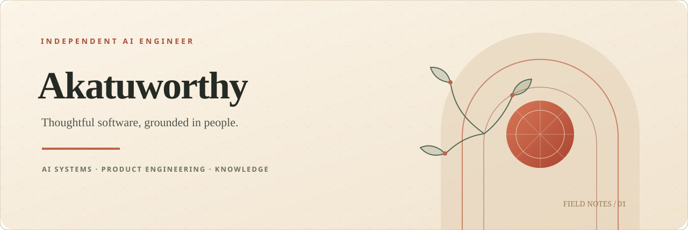
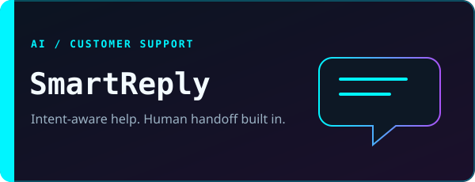
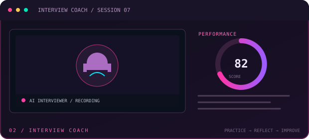
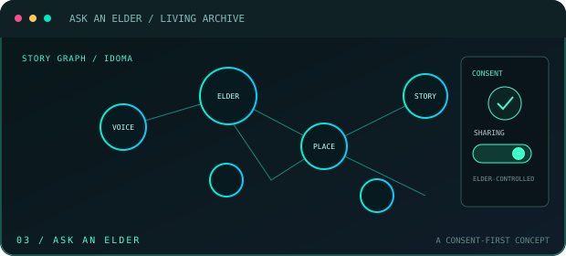

 

<code>AI SYSTEMS</code> &nbsp; <code>PRODUCT ENGINEERING</code> &nbsp; <code>KNOWLEDGE TOOLS</code>

  

&nbsp;

---

<table>
<tr>
<td width="58%" valign="top">

### &gt; PROFILE / OPERATOR

I turn human problems into useful software. My work spans AI, APIs, and web interfaces, with a focus on practical language tools, retrieval, and voice workflows.

**Core directive:** build technology that is useful, understandable, and worthy of people's trust.

</td>
<td width="42%" valign="top">

### &gt; TECH STACK

</td>
</tr>
</table>

## &gt; FEATURED BUILDS

<table>
<tr>
<td width="33%" align="center" valign="top">

</td>
<td width="33%" align="center" valign="top">

</td>
<td width="33%" align="center" valign="top">

</td>
</tr>
</table>

**OTHER DEPLOYMENTS**  
[SmartBudgetTracker](https://github.com/akatuworthy-eng/SmartBudgetTracker) &nbsp;·&nbsp; [techmate](https://github.com/akatuworthy-eng/techmate) &nbsp;·&nbsp; [AI Travel Companion](https://github.com/akatuworthy-eng/ai-travel-companion) &nbsp;·&nbsp; [AI Agent Scaffold](https://github.com/akatuworthy-eng/base_ai_agent)

---

### &gt; NEXT FRONTIER

**Ask an Elder** — exploring a consent-first way to preserve Idoma oral knowledge.

 

[**INITIATE CONTACT ↗**](mailto:akatuworthy@gmail.com) &nbsp; · &nbsp; [ACCESS ALL REPOSITORIES](https://github.com/akatuworthy-eng?tab=repositories)

Building tools that preserve what matters.

